# MusicBrainz Explorer: Project Documentation

Technical and Scientific Programming, Deusto · November 2026

## Contents

1. [Introduction](#1-introduction)
2. [Dataset](#2-dataset)
3. [Data loading](#3-data-loading-01_loadr)
4. [Data quality audit and cleaning](#4-data-quality-audit-and-cleaning-02_auditr-03_cleanr)
5. [Integration and transformation](#5-integration-and-transformation-04_integrate_transformr)
6. [Exploratory analysis](#6-exploratory-analysis-05_explorer)
7. [Web application](#7-web-application-appr)
8. [Music recommender](#8-music-recommender-music-recommender)
9. [Deployment](#9-deployment-deploy)
10. [How to reproduce](#10-how-to-reproduce)
11. [Conclusions and limitations](#11-conclusions-and-limitations)

## 1. Introduction

MusicBrainz Explorer turns the full MusicBrainz database (about 28 GB of raw text) into ten verified findings about recorded music and an interactive web app that shows them. It was built for the Technical and Scientific Programming course at Deusto and covers every stage the brief asks for: loading, cleaning, integration, dplyr transformation, ggplot exploration and a dynamic web app.

The project asks four kinds of question:

- **Over time:** how releases, formats, genres and song length changed from 1878 to 2025.
- **Geography:** which genres, languages and record labels dominate in each country.
- **Artists:** how women are represented in band roles, and how career length relates to output.
- **Discovery:** given an artist, which similar artists a listener might like (the recommender).

The work is split into five R scripts that run in order, a Shiny app that reads their results, a music recommender, and a Docker setup to publish the app.

| Deliverable | Files |
| --- | --- |
| Data pipeline | `01_load.R`, `02_audit.R`, `03_clean.R`, `04_integrate_transform.R`, `05_explore.R` |
| Web app | `app.R` |
| Recommender | `music-recommender/` |
| Deployment | `deploy/` |
| Figures and summaries | `output/figures/`, `data/analysis/` |

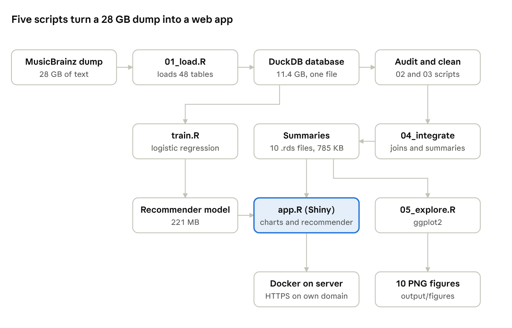

Each script reads what the one before it wrote. The app needs only the summaries for its charts, plus the database and the model for recommendations.

## 2. Dataset

The data is the full MusicBrainz database export (mbdump) of 14 November 2026, schema sequence 31: 213 tables and about 28 GB of tab-separated text. MusicBrainz is an open, community-maintained encyclopedia of music, and its core data is released under the CC0 public-domain licence, so it can be used freely ([musicbrainz.org](https://musicbrainz.org/doc/MusicBrainz_Database)).

The project loads 48 of the 213 tables (about 20 GB), grouped into eight themes:

| Theme | What it holds | Main tables |
| --- | --- | --- |
| artists | Artists, their type, gender, area and country | `artist`, `area`, `gender`, `artist_type` |
| genres | Community tags and the curated genre list | `tag`, `genre`, `artist_tag`, `release_group_tag`, `recording_tag` |
| credits | Who is credited on an album or song | `artist_credit`, `artist_credit_name` |
| albums | Albums, their editions, dates, countries and formats | `release_group`, `release`, `release_country`, `medium` |
| members | Band membership and instruments | `l_artist_artist`, `link`, `instrument` |
| labels | Record labels and what they published | `label`, `release_label` |
| languages | Compositions and their lyrics language | `work`, `work_language`, `language` |
| songs | Recordings and tracks | `recording` (41 M rows), `track` (59 M rows) |

The largest loaded tables are `track` (59.0 M rows), `recording` (41.0 M), `release_country` (13.4 M), `medium` (6.5 M), `release` (5.9 M), `release_group` (4.6 M) and `artist` (3.0 M).

The raw dump is never modified. It stays outside the project folder (`C:/Users/Usuario/MusicBrainzRaw/mbdump`) and is only read by `01_load.R`.

## 3. Data loading (`01_load.R`)

The 48 tables are loaded into a single DuckDB database file, `data/musicbrainz.duckdb` (11.4 GB), instead of R data frames. The song tables alone are 4.7 GB (`recording`) and 8 GB (`track`), more than a laptop can hold in RAM. DuckDB runs inside R, reads the text files directly and stores them compressed on disk. Every table is then used with ordinary dplyr verbs through dbplyr, and only small results are brought into memory with `collect()`.

The raw files were opened and checked before writing the loader. They have no extension and no header row, are tab-separated UTF-8, write missing values as `\N` (PostgreSQL COPY format), keep empty text as an empty field, use no quoting and write booleans as `t`/`f`.

The script works in six steps:

1. **Paths and scope.** Sets the project folder and the raw dump folder, and lists the eight themes to load. The `songs` theme is 15 of the 20 GB and can be left out for a quick first run.
2. **Schema.** Reads `schema/mb_schema.csv` with `readr::read_csv()` and explicit column types. The file has one row per column (theme, table, position, column name, PostgreSQL type, DuckDB type), taken from the official `CreateTables.sql`.
3. **Format check.** For every file, checks that it exists and that its first 1,000 lines have exactly as many tab-separated fields as the schema says. A wrong schema version stops the run here, before a long load starts.
4. **Load.** Each table is created with DuckDB's `read_csv()` using the schema's names and types, `nullstr = '\N'`, no quoting and `auto_detect = false`, so nothing is guessed. Errors are not ignored, so a table that loads has had every line parsed. Tables already in the database are skipped, and the smallest files load first so problems show up early.
5. **Summary.** Prints rows, columns and file size per table, and the final database size.
6. **First look through dplyr.** `tbl(con, "artist")` with `glimpse()` and `count(type)`, showing that dplyr verbs are translated to SQL and run inside DuckDB.

## 4. Data quality audit and cleaning (`02_audit.R`, `03_clean.R`)

The data turned out to be structurally clean but very incomplete. No duplicate identifiers and no broken references were found. However, 80% of artists have no begin year, 58% have no gender and 4.1 M songs have no length. Cleaning therefore labels and flags rather than deletes.

### 4.1 Audit

`02_audit.R` changes nothing. It measures every problem with dplyr queries that run inside DuckDB and saves the results to `output/audit.rds`. It covers six groups of checks (A to F):

| Check | What was measured | Result |
| --- | --- | --- |
| A. Explicit missing values | NA per column of 12 main tables | Artist begin year missing for 79.9%, gender 57.6%, area 50.3%, type 22.7% |
| B. Implicit missing values | Empty text, placeholder artists | 39.1 M empty song comments; "Various Artists" (651,335 credits), "[unknown]" and "[no artist]" are among the 7 most credited artists |
| C. Duplicates | Unique keys, unique key pairs, shared names | 0 duplicated keys in 10 tables and 0 duplicated pairs in 5 link tables; 132,003 names are shared by 439,967 different artists |
| D. Outliers and impossible values | Dates, lifespans, release years, song length, tag votes, text | Begin years from −535 to 4428; album years from 29 to 3036; one song lasting 24 days (2,096,661,000 ms); 181,763 tags with 0 or negative votes |
| E. Inconsistencies | 12 foreign-key references | 0 orphan rows |
| F. Coverage | Share of rows with each analysis variable | Artist genre tag 7.2%, album genre tag 35.2%, work lyrics language 64.3% |

### 4.2 Cleaning

`03_clean.R` applies the decisions that follow from the audit. Raw tables are never changed: each cleaned table is written next to the original with a `_clean` suffix. The `save_table()` helper turns a dplyr pipeline into a database table with `sql_render()`. The effect of every rule is saved to `output/cleaning_log.rds`.

| Problem | Decision | Effect |
| --- | --- | --- |
| Missing dates, area, song length | Left as NA; each analysis uses only rows that have its variable. Filling 80% of birth years with a mean would invent data. | Nothing removed |
| Missing artist or album type | Labelled "Unknown" so the rows still count in totals | 690,574 artists, 104,050 albums |
| Missing gender | "Not applicable" for groups, orchestras and choirs; "Unknown" for the rest | 696,890 not applicable, 1,059,251 unknown |
| Empty comments | Converted to NA | All comment columns |
| Placeholder artists | Kept, flagged with `is_placeholder` so they can be excluded | 17 flagged; bracketed real names such as "[Alexandros]" kept |
| Impossible artist dates | Set to NA: future years, year 0, end before begin, persons over 110 years. Old but possible dates (Sophocles) are kept. | 82 artists |
| Release years outside 1877–2026 | Set to NA (before the phonograph or in the future) | 391 albums, 373 country releases; range is now 1878–2026 |
| Label founding before 1450 or in the future | Set to NA | 30 labels |
| Songs over 24 hours | Set to NA | 229 songs |
| Unusual song lengths | Labelled with the 1.5 × IQR rule on the log scale, not removed. On the raw scale it would flag 2 M normal long tracks. | 2.06 M unusually short, 0.78 M unusually long |
| Tags with 0 or negative votes | Removed (rejected by the community) | 181,763 rows |
| Doubled backslashes in names | Restored to one backslash (an artefact of the export format) | 6 tables |

## 5. Integration and transformation (`04_integrate_transform.R`)

The cleaned tables are joined into four analysis tables inside DuckDB, then summarised into small `.rds` files in `data/analysis/`. The web app reads only these files, so it does not need the 11 GB database for its charts.

### 5.1 Integration (part A)

| Table | One row per | How it is built |
| --- | --- | --- |
| `area_country` | Area (city, region, country) | Walks up the `l_area_area` "part of" links until it reaches an area with an ISO country code. Both tables are small (120,000 rows), so this is done in R. |
| `artist_genre` | Artist × genre | A tag counts as a genre only if it is in MusicBrainz's curated genre list. Only 7% of artists carry a genre tag, but 35% of albums do, so artists also inherit the genre tags of albums credited to them (`artist_credit_name` → `release_group`). |
| `artist_profile` | Artist | Country, main genre (most votes, ties broken alphabetically) and discography size. Real artists with a known country are the population for the country charts. |
| `recording_year` | Song | A recording has no date of its own: its year is the earliest first-release year of the albums it appears on (`track` → `medium` → `release` → `release_group`). |

### 5.2 Transformation (part B)

Each summary is a dplyr pipeline run in DuckDB, collected into R and saved with `saveRDS()`. Together with the correlation matrix from `05_explore.R`, the ten files take 785 KB.

| File | Rows | Content |
| --- | --- | --- |
| `genre_by_country.rds` | 40,710 | Artists per genre and country, and the genre's share of the country's tagged artists |
| `genre_by_year.rds` | 44,199 | Albums per genre and year, with share of tagged albums |
| `albums_by_year.rds` | 633 | Albums per year and type (album, single, EP...) |
| `band_roles.rds` | 10,330 | Band memberships by instrument or vocal role, gender and country |
| `song_length_by_year.rds` | 140 | Mean, median and quartiles of song length per year |
| `language_by_country.rds` | 2,295 | Lyrics languages of works by the country of their writer |
| `top_labels.rds` | 5,000 | Record labels ranked by number of releases |
| `song_length_by_genre.rds` | 1,383 | Song length by the artist's main genre |
| `song_length_by_genre_decade.rds` | 5,939 | The same, by decade |
| `artist_correlations.rds` | 7 | Spearman correlation matrix of 7 artist variables (written by `05_explore.R`) |

The script uses a wide set of dplyr verbs: `select`, `filter`, `mutate`, `transmute`, `rename`, `arrange`, `distinct`, `count`, `group_by`, `summarise`, `inner_join`, `left_join`, `anti_join`, `union_all`, `bind_rows`, `case_when`, `if_else`, `coalesce`, `row_number`, `n_distinct` and dbplyr's `window_order`.

## 6. Exploratory analysis (`05_explore.R`)

Ten ggplot2 figures answer the project's questions, and each headline below was checked against the numbers behind it. The script prints the figures needed to read each graph and saves every figure as a PNG in `output/figures/`. Yearly series run from 1950 to 2025, because earlier years are small and noisy and 2026 is incomplete (the dump is from November 2026).

| Figure | Chart type | Finding |
| --- | --- | --- |
| G1 Releases per year by type | Lines, 4 series | Singles overtook albums in 2019 (78,478 singles against 72,010 albums) |
| G2 Genre share over time | Lines, 6 series | Pop and jazz declined while electronic music caught up with rock |
| G3 Genres by country | Heatmap | Rock or electronic leads in almost every country; France is the only top-12 country led by hip hop |
| G4 Women by role in bands | Ranked bars | Violinists are 47.5% women; drummers 4.1% and guitarists 6.1% |
| G5 Song length over time | Median with interquartile band | Songs grew longer until 2012 and have been getting shorter since |
| G6 Lyrics languages by country | Stacked share bars | English is the first lyrics language in Sweden and the second across northern Europe |
| G7 Largest record labels | Ranked bars | Columbia leads with 43,523 releases, far ahead of any other label |
| G8 Correlations between artist variables | Correlation matrix | Career length and number of releases are the most strongly linked pair |
| G9 Career length vs releases | Median and middle half per band of career length | Long careers mean many releases: Spearman correlation 0.89 |
| G10 Song length by genre | Median and middle half per genre | Song length differs clearly between genres |

The figures share one look: a fixed six-colour palette for categories, always in the same order, a blue ramp for magnitudes, and blue and red around a neutral grey for correlations. Besides the graphs, the script prints descriptive statistics and the full correlation matrix, which it saves as `artist_correlations.rds` for the web app.

### 6.1 Figures

**G1. Releases per year by type**

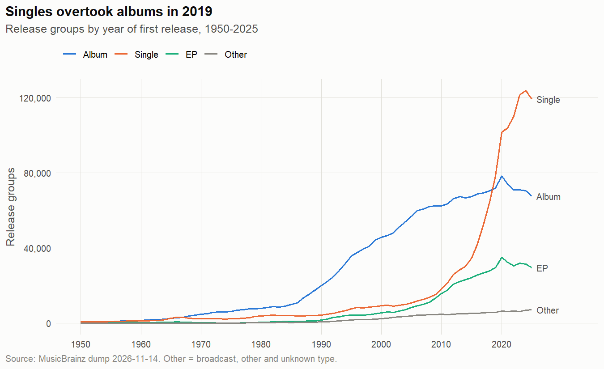

**G2. Genre share over time**

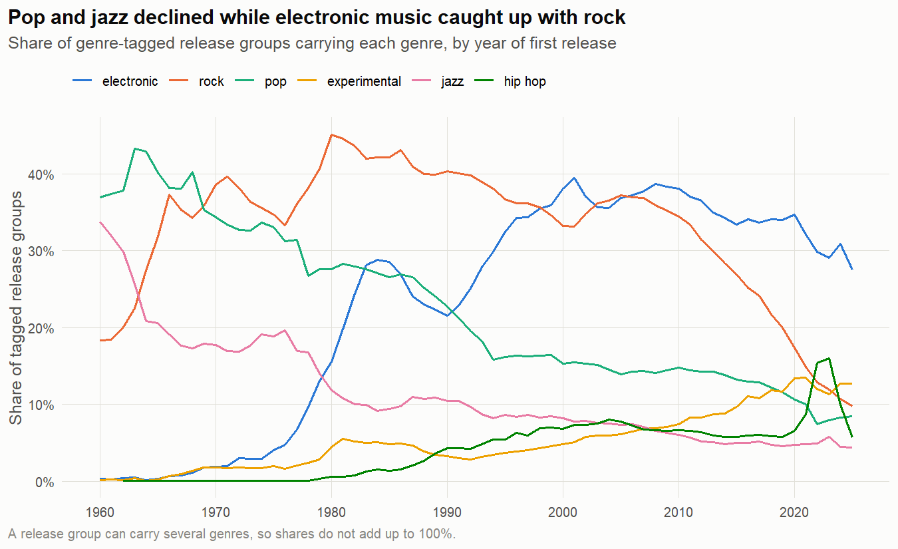

**G3. Genres by country**

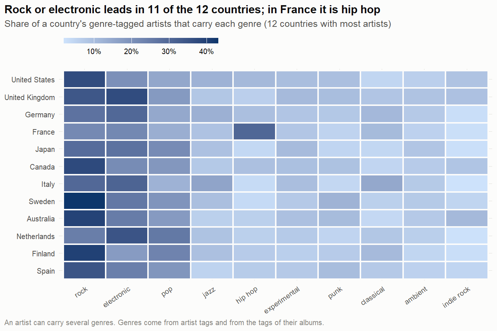

**G4. Share of women by role in bands**

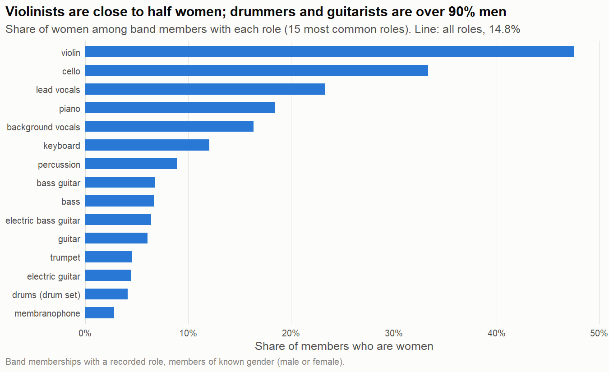

**G5. Song length over time**

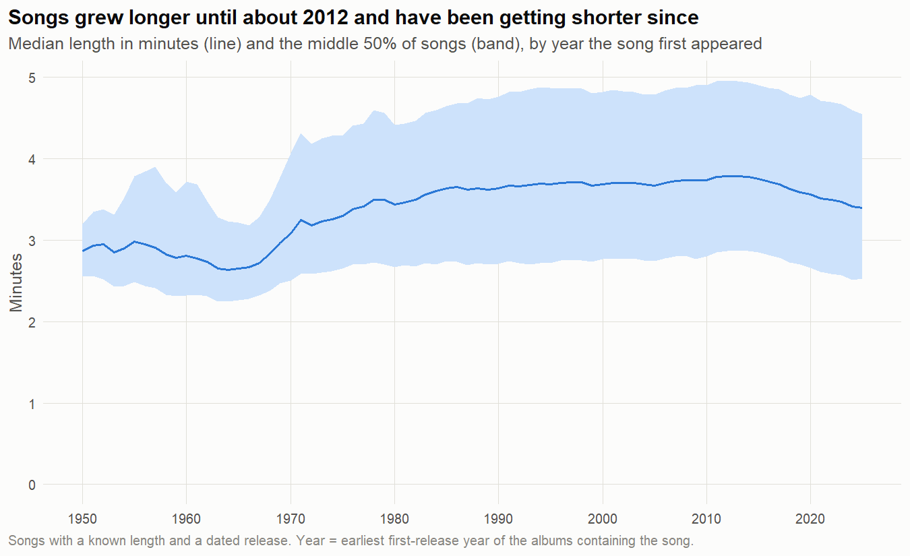

**G6. Lyrics languages by country**

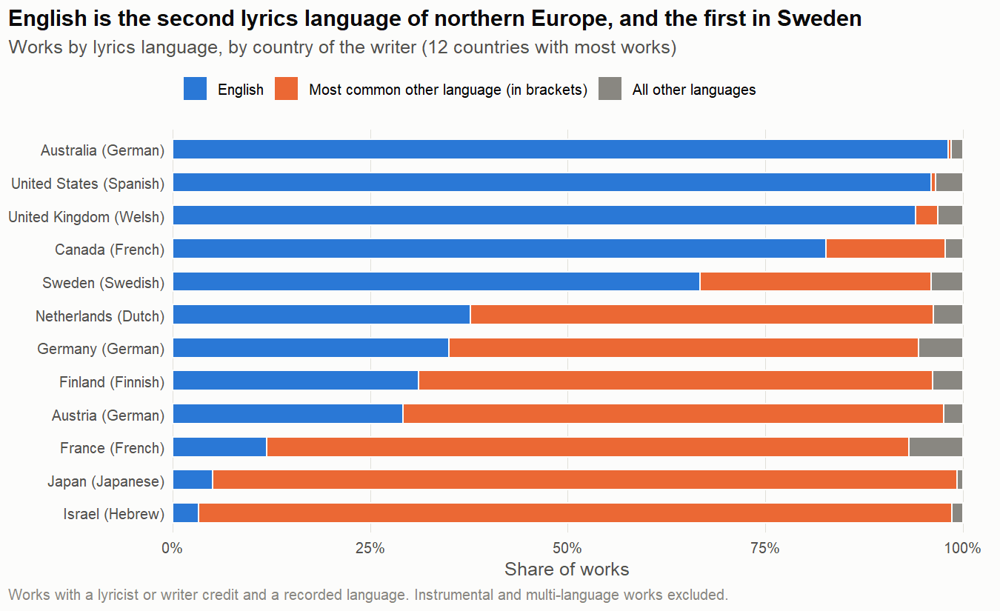

**G7. Largest record labels**

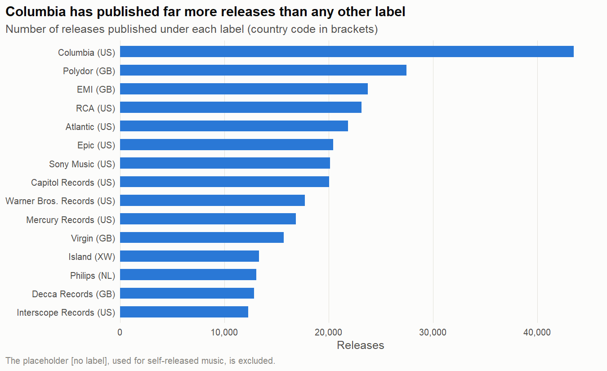

**G8. Correlations between artist variables**

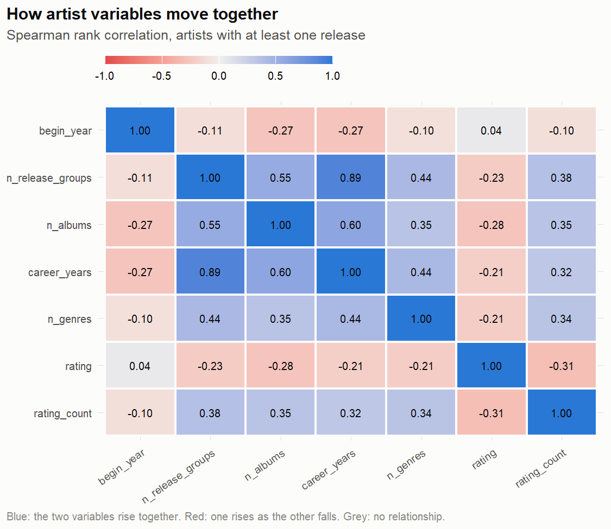

**G9. Career length vs number of releases**

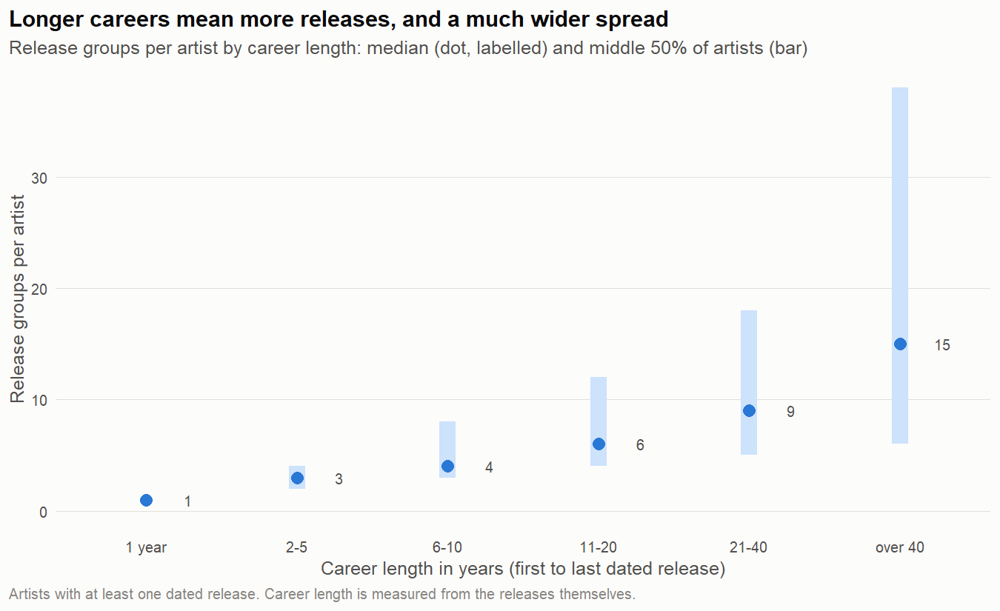

**G10. Song length by the artist's genre**

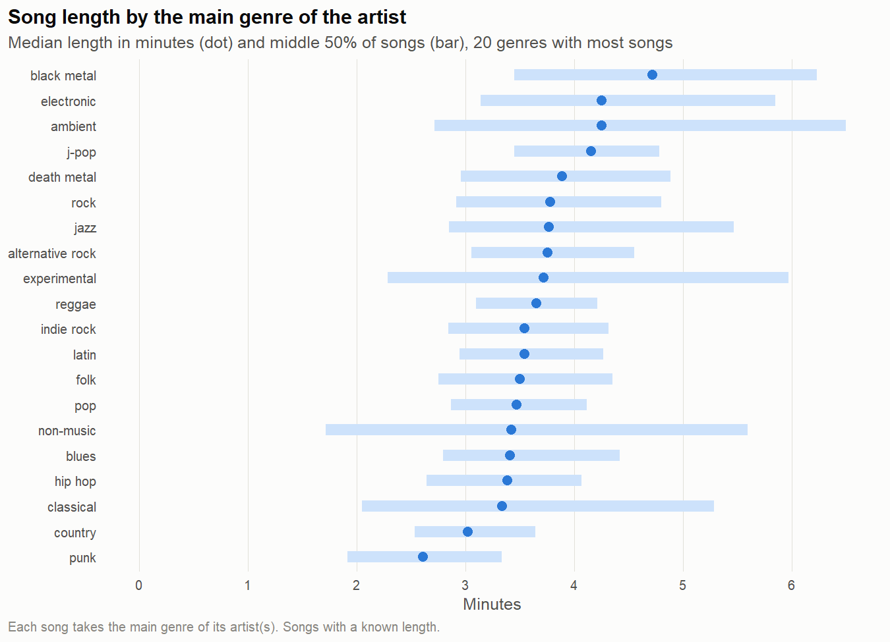

## 7. Web application (`app.R`)

The Shiny app turns the ten findings into interactive pages: every chart has filters that change what is drawn and shows exact values on hover. It is built with Shiny 1.14 and bslib 0.12, and each ggplot2 chart becomes interactive through `plotly::ggplotly()`. Charts read only the `.rds` summaries; the Recommendations page also reads the database and the recommender model.

### 7.1 Pages

| Menu | Page | What the user can do |
| --- | --- | --- |
| Overview | Overview | Read the headline stats (from `output/audit.rds`) and nine story cards, one per finding; jump to a chart or to the recommender |
| Music over time | Releases, Genres over time, Song length | Pick years, release types or genres; switch between counts and shares |
| Around the world | Genres by country, Lyrics languages, Labels | Pick countries, genres or the number of labels shown |
| Artists | Band roles, Songs by genre, Artist variables | Filter roles by country, view song length overall or by decade, read the correlation matrix |
| Recommendations | Recommendations | Search an artist, song or album and get similar music (section 8) |

Every chart page has the same layout: a filter sidebar on the left and a card on the right. The card holds the finding as its headline, a **Chart** tab and a **Data** tab with the exact table behind the chart, plus a footer note on how to read it.

### 7.2 How the code is organised

- **Data block.** Reads each summary once at start-up and prepares it for the charts, for example the share of each release type within its year.
- **`stories` list.** One entry per finding: menu, page title, verified headline and description. The overview cards and the chart headers are built from it, so a headline is written once.
- **`chart_tab()` and `story_card()`.** Helpers that build every chart page and every overview card from the `stories` list, so all pages look the same.
- **Server.** One `renderPlotly()` and one `renderTable()` per page, reacting to that page's filters. `observeEvent()` handlers connect the overview buttons to the pages with `nav_select()`.
- **`to_plotly()`.** Converts each ggplot to plotly with one shared style: system font, clean hover labels and a transparent background.

### 7.3 Design

The app uses a dark navy navigation bar (`#0d1b2e`), a warm off-white page (`#f9f9f7`) and one blue accent (`#2a78d6`), the same blue as the static figures. The overview opens with a full-width banner, "Nearly 150 years of recorded music, in numbers", and two buttons: **Start exploring** and **Find similar music**. The layout was checked with screenshots on desktop and mobile widths.

To run it locally: `shiny::runApp("<project folder>")`, or `music-recommender/start.ps1 -WithOllama` to also start the local language model.

## 8. Music recommender (`music-recommender/`)

The recommender suggests artists and songs similar to one the user picks. It combines genre similarity with a logistic regression trained on shared credits, which ranks real collaborators above random artists of the same genre with a holdout AUC of 0.783. MusicBrainz has no listening history or audio, so recommendations come from catalog relationships, not from sound or user behaviour. For example, a search for Portishead returns Massive Attack, Morcheeba, Bonobo and Tricky.

### 8.1 Training (`train.R`)

`train.R` reads the project database in read-only mode and writes a separate 221 MB model file, `model/artists.duckdb`.

1. **Artists.** 3,041,865 real artists from `artist_profile`, with placeholders removed.
2. **Genre profiles.** Each of the 574,514 genre-tagged artists gets a vector over 1,839 genres. A genre's weight is ln(1 + votes) × IDF, so rare genres count more than common ones, and each vector is scaled to length 1.
3. **Labels.** Two artists credited together on a release with 2 to 4 artists form a positive pair (2,150,614 such pairs exist). A random artist of the same main genre who never shared a credit forms a negative pair.
4. **Model.** A logistic regression (`glm`, binomial) is fitted on 38,293 pairs and tested on 9,554 held-out pairs.

| Variable | Meaning | Coefficient |
| --- | --- | --- |
| `cosine` | Genre-profile cosine similarity | −0.03 |
| `log_shared` | ln(1 + number of shared genres) | +1.15 |
| `year_gap` | Gap between first release years, scaled to 25 years, capped at 60 | −0.84 |
| `same_country` | Both artists from the same country | +1.82 |

Same country, shared genres and similar eras predict collaboration. Cosine similarity adds almost nothing once the number of shared genres is known, because negative pairs were drawn from the same main genre.

### 8.2 Ranking (`model.R`, `recommendations.R`, `catalog.R`)

For a chosen artist, candidates that share genres or credits are scored as:

```
score = (0.65 × cos + 0.25 × p_collab + 0.10 × credits) × (0.70 + 0.30 × popularity)
```

Here `cos` is the genre cosine, `p_collab` is the logistic model's probability and `credits` is the shared credit count scaled to between 0 and 1. `popularity` is the artist's rating count, also scaled to between 0 and 1, so well-known artists are favoured without hiding niche ones. Song recommendations also use recording tags, year, duration and rating count. Album searches start from the album's credited artists. `catalog.R` handles search-as-you-type across artists, songs and albums.

### 8.3 Natural-language search (`llm.R`)

A local Qwen3 4B model, run through Ollama, turns a request such as "Recommend songs like Teardrop by Massive Attack" into a structured search: query, artist, kind and what to recommend. The model's output is forced to follow a JSON schema. `llm.R` only accepts a local address (`127.0.0.1`, `localhost` or `::1`) and rejects cloud models, so the request text never leaves the machine. The model only interprets the request; the recommendations themselves come from the catalog.

## 9. Deployment (`deploy/`)

The app is packaged with Docker so that it can run on a home Linux server (64 GB of RAM, no GPU) and be reached over HTTPS on the student's own domain. This setup has not yet been tested on the server. The step-by-step guide is in `deploy/README.md`.

| File | Role |
| --- | --- |
| `Dockerfile` | Builds the app image on `rocker/r-ver:4.5.3` with binary packages from Posit Package Manager. Checks that duckdb is at least 2.0.0, the version that wrote the database, and runs the app as a non-root user on port 3838. |
| `docker-compose.yml` | Runs the app, the Ollama language model and one way in from the internet |
| `Caddyfile` | Reverse proxy with automatic HTTPS certificates for option B |
| `../.dockerignore` | Keeps the 11 GB database, the model and the figures out of the image |

Design choices:

- **Data is mounted, not copied.** The database and the recommender model are mounted read-only from the server's disk, so the image stays small and a new dump needs no rebuild.
- **The language model stays private.** Ollama shares the app container's network (`network_mode: service:app`) and listens only on `127.0.0.1:11434`. This keeps `llm.R`'s local-only rule without code changes, and Ollama is never reachable from outside. It runs on the CPU, and the model stays loaded (about 3 GB of RAM) to avoid slow first answers.
- **Two ways in, chosen with a Compose profile.** `--profile tunnel` runs Cloudflare Tunnel, which needs no router changes. `--profile caddy` runs Caddy, which needs ports 80 and 443 forwarded on the router. Secrets (`TUNNEL_TOKEN`, `DOMAIN`) live in `deploy/.env`, not in the code.
- **Restarts by itself.** Every service uses `restart: unless-stopped`, so the site comes back after a server reboot.

## 10. How to reproduce

The whole project rebuilds from the raw dump by running five scripts in order and then the app. It needs R 4.5 or later with duckdb 2.0.0 or later, about 30 GB of free disk for the dump and the database, and around 1 GB more for the recommender model.

**Packages:** DBI, duckdb, dbplyr, dplyr, tidyr, readr, ggplot2, scales for the pipeline, plus shiny, bslib, plotly, httr and jsonlite for the app. Ollama with `qwen3:4b` is optional and only needed for natural-language search.

1. Download the MusicBrainz full export (mbdump) and set `mb_dir` in `01_load.R` to its folder.
2. Open the project folder in R (or `setwd()` to it). Every script expects it as the working folder.
3. Run `01_load.R` to build `data/musicbrainz.duckdb`. This is the longest step.
4. Run `02_audit.R`, then `03_clean.R`.
5. Run `04_integrate_transform.R` to create the analysis tables and `data/analysis/*.rds`.
6. Run `05_explore.R` to draw the ten figures.
7. Optionally run `music-recommender/train.R` to build the recommender model.
8. Start the app with `shiny::runApp(".")`, or follow `deploy/README.md` to put it online.

```
R project/
  01_load.R ... 05_explore.R     pipeline scripts, run in order
  app.R                          Shiny web app
  schema/mb_schema.csv           column names and types of the 48 tables
  data/
    musicbrainz.duckdb           loaded and cleaned database (11.4 GB, not in git)
    analysis/*.rds               10 summaries read by the app (785 KB)
  output/
    audit.rds, cleaning_log.rds  results of the audit and of every cleaning rule
    figures/g1 ... g10 .png      static figures
  music-recommender/             recommender code; model/ holds the trained model (not in git)
  deploy/                        Dockerfile, docker-compose.yml, Caddyfile, guide
  docs/
    DOCUMENTATION.md             this document
    project_instructions.pdf     the assignment
```

## 11. Conclusions and limitations

The project shows that a 28 GB database can be cleaned and analysed on a normal laptop with dplyr, by keeping the data in DuckDB and bringing only small results into R. The main lessons are about the data: MusicBrainz is structurally sound (0 duplicate keys, 0 broken references) but very unevenly filled in, so every finding rests on the subset of rows that has the variable it needs.

Limitations:

- **Coverage bias.** Only 7% of artists carry their own genre tag and 20% have a begin year. Genre and career findings describe the documented part of the catalog, which leans towards Western, popular and well-catalogued music.
- **Volunteer data.** MusicBrainz grows as editors add music, so recent years and some countries are better covered than others. Release counts measure what was catalogued, not what was published.
- **Genre inheritance.** Artists inherit the genres of their albums, which can blur artists who work across several styles.
- **Recommender proxy.** Shared credits stand in for "similar" because there is no listening data. The holdout AUC (0.783) measures how well the model finds collaborators, not how much listeners like the suggestions.
- **Deployment untested.** The Docker setup is validated but has not run on the server yet, and several users at once on the read-only database is untested.
